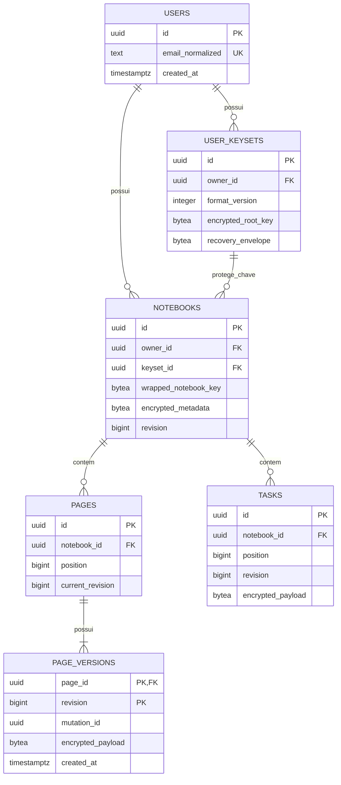

# Desenho do banco SQL — Library4

O modelo conceitual abaixo orienta o produto. A implementação inicial foi aplicada localmente: a fonte executável e exata é [db/001-foundation.sql](../db/001-foundation.sql). Referências de produto: [proposta](proposta.md) e [requisitos](requisitos-funcionais.md).

## Implementação local atual

PostgreSQL 17.5, instância separada na porta 5547, schema `library4`. Tabelas: `users`, `sessions`, `user_keysets`, `notebooks`, `pages`, `page_versions`, `tasks`, `notebook_mutations`; controle de migração em `public.library4_migrations`.

- Envelopes reais são `JSONB` com `{v:1, iv:base64, data:base64}`. AES-GCM usa nonce aleatório de 12 bytes e tag de 128 bits no campo `data`; AAD vincula o contexto informado pelo cliente. O desenho binário conceitual abaixo não é o formato executado.
- Conta guarda e-mail, nome de exibição e hash scrypt. Sessão guarda somente hash SHA-256 do token, com validade de sete dias. Conta e horários são metadados operacionais visíveis, não conteúdo de caderno.
- Um keyset por proprietário guarda `root_envelope` com envelope AES-GCM e parâmetros `kdf`: PBKDF2, SHA-256, 600.000 iterações, salt aleatório de 16 bytes. A senha de conteúdo aprovada deriva uma chave somente no navegador. Caderno guarda `wrapped_key` e `encrypted_metadata`; não há chave legível armazenada. AAD vincula raiz a conta/keyset; demais envelopes a proprietário, caderno, entidade e revisão.
- Página referencia a versão atual com FK diferida; posições únicas diferidas permitem reordenação atômica. Criação do caderno, página e versão inicial é uma transação.
- Salvamento bloqueia a linha do caderno, compara revisão esperada e grava páginas/metas/metadados conjuntamente. `notebook_mutations` registra identificador, hash da requisição e resultado: repetição idêntica retorna o mesmo resultado; conteúdo diferente com mesmo identificador é rejeitado.
- A API consulta até 50 versões por página e remove versões mais antigas ao salvar. Recibos de mutação ainda não expiram; definir retenção antes de uso amplo. Não há exclusão de caderno nem tabelas sociais antecipadas.
- Organização inicial usa `organization: { shelves: string[], favorite: boolean }` dentro do envelope `encrypted_metadata`. Nomes/associações não são colunas SQL legíveis; comparação, busca e agrupamento acontecem após desbloqueio. Padrão de caderno antigo: lista vazia/favorito falso. Estantes independentes vazias e renomeação coletiva exigem evolução posterior; esta rodada não cria tabelas nem muda revisão/idempotência.
- Preferências cifradas incluem `ruling`, `desk`, `light`, `binding` e `reminder`, com opções enumeradas e defaults compatíveis. Estilos de trecho ficam na string `content` da página como extensão restrita de Markdown; envelopes, versões, AAD e revisão não mudam. Busca de páginas ocorre somente após desbloqueio, sem colunas/índices SQL de texto privado.
- Revisão visual: `coverColor` aceita somente hexadecimal de seis dígitos ou vazio e `finish` somente `leather/cloth/smooth`, dentro das mesmas preferências cifradas. Tiptap exporta para a string Markdown da página; não há JSON de editor legível no SQL. Marcador visual `{{l4;fonte;tinta;tamanho}}Markdown{{/l4}}` usa opções enumeradas e preserva estilos antigos literais. Capa/contracapa são estados da interface, sem registros extras em `pages` ou contagem de produção. Nenhuma migração nesta rodada.

Testes contra o banco real verificam autorização entre contas, conflitos, repetição de requisição, histórico e criação atômica. Não existe publicação implementada nem promessa de recuperação de conteúdo sem o segredo do usuário.

## 1. Escolhas de desenho

O desenho conceitual usa PostgreSQL, agora aprovado para implementação local. IDs `UUID` são gerados pela aplicação e horários usam `TIMESTAMPTZ`. Neon continua candidato para hospedagem futura, sem contratação.

SQL guarda relações, ordem, revisões e envelopes criptografados. O cliente interpreta Markdown e dados privados depois de desbloqueá-los. Não haverá colunas legíveis de título, matéria, tags, texto, descrição de tarefa ou contagem de palavras privadas.

`BYTEA` representa envelope binário criptografado com versão de formato, algoritmo, nonce e tag de autenticação. O formato será especificado antes das migrações; não concatenar campos ad hoc nem criar algoritmo próprio. Identidade da entidade, proprietário e revisão devem ser vinculados à proteção criptográfica para impedir troca silenciosa de payloads entre registros.

## 2. Diagrama do MVP

Uma página recém-criada já possui revisão inicial, mesmo vazia. Página e primeira versão são inseridas na mesma transação. O estado confirmado é a versão identificada por `current_revision`.

## 3. Dicionário de tabelas

### users — identidade da conta

| Campo | Tipo sugerido | Regra |
| --- | --- | --- |
| id | UUID | PK, não nulo. |
| email_normalized | TEXT | Não nulo, único após normalização definida. Identificação operacional visível ao serviço. |
| created_at | TIMESTAMPTZ | Não nulo, horário do servidor. |
| updated_at | TIMESTAMPTZ | Não nulo. |

Credenciais e sessões dependem do mecanismo de autenticação escolhido. Se próprio, adicionar armazenamento de hash de senha e tokens de sessão/recuperação protegidos; se gerenciado, mapear a identidade do provedor com unicidade. Não guardar senha em texto nem definir um framework por meio deste desenho.

### user_keysets — material criptográfico protegido

| Campo | Tipo sugerido | Regra |
| --- | --- | --- |
| id | UUID | PK. |
| owner_id | UUID | FK → users.id, não nulo. |
| format_version | INTEGER | Positivo; versão do protocolo/envelope. |
| encrypted_root_key | BYTEA | Chave raiz protegida no cliente; servidor não pode desbloqueá-la sozinho. |
| unlock_parameters | JSONB | Parâmetros públicos de desbloqueio, se exigidos pelo protocolo; nunca senha/chave legível. |
| recovery_envelope | BYTEA | Envelope para o método de recuperação aprovado; não contém segredo de recuperação legível. |
| created_at | TIMESTAMPTZ | Não nulo. |

Criar `UNIQUE (id, owner_id)` para permitir vínculo composto de propriedade. Não confundir essa chave com credencial de login. A árvore de chaves proposta é chave raiz do usuário → chave de caderno → payloads; proteção e recuperação ainda precisam de especificação criptográfica.

Trocar o meio de desbloqueio pode reproteger a mesma chave raiz; trocar a chave raiz exige reproteger dependências. Não apagar keysets enquanto dados ou backups recuperáveis dependerem deles.

### notebooks — cadernos

| Campo | Tipo sugerido | Regra |
| --- | --- | --- |
| id | UUID | PK. |
| owner_id | UUID | FK → users.id, não nulo; proprietário imutável no MVP. |
| keyset_id | UUID | Não nulo; FK composta `(keyset_id, owner_id)` → user_keysets `(id, owner_id)`. |
| wrapped_notebook_key | BYTEA | Chave do caderno protegida pela chave raiz; nunca legível ao servidor. |
| encrypted_metadata | BYTEA | Nome, matéria e tags dentro do envelope. |
| revision | BIGINT | Positivo; controle de concorrência dos metadados. |
| created_at / updated_at | TIMESTAMPTZ | Não nulos. |

Nome e tags privados não recebem índice textual no servidor. A FK composta impede associar o caderno ao keyset de outra conta. Ela não substitui autorização de requisições.

### pages — identidade e posição da página

| Campo | Tipo sugerido | Regra |
| --- | --- | --- |
| id | UUID | PK. |
| notebook_id | UUID | FK → notebooks.id, não nulo; vínculo imutável no MVP. |
| position | BIGINT | Não negativo; ordem de apresentação. |
| current_revision | BIGINT | Positivo; aponta para versão existente desta página. |
| created_at / updated_at | TIMESTAMPTZ | Não nulos. |

`UNIQUE (notebook_id, position)`; definir atualização de posições em transação, sem colisões intermediárias. Formato e capacidade em linhas ficam no payload criptografado da versão; o cliente aplica a regra de capacidade aprovada. O servidor não pode contar linhas de conteúdo criptografado, mas continua limitando tamanho de requisição e armazenamento.

Adicionar FK composta `(id, current_revision)` → page_versions `(page_id, revision)`, adiada até o fim da transação para permitir criar página e versão inicial juntas. Esse vínculo circular é intencional; a migração cria as tabelas primeiro e acrescenta a FK depois. Confirmar suporte do banco escolhido antes de gerar DDL.

### page_versions — conteúdo e histórico

| Campo | Tipo sugerido | Regra |
| --- | --- | --- |
| page_id | UUID | FK → pages.id, não nulo. |
| revision | BIGINT | Positivo; PK composta com page_id. |
| mutation_id | UUID | Identifica tentativa lógica de gravação; único por página. |
| encrypted_payload | BYTEA | Título, Markdown, formato selecionado, capacidade em linhas e metadados privados da versão. |
| created_at | TIMESTAMPTZ | Não nulo, horário de confirmação no servidor. |

`UNIQUE (page_id, mutation_id)`. Versions são imutáveis após gravadas. A mesma mutação reenviada com payload diferente é rejeitada, não tratada como edição nova.

Proposta mínima inicial: cada gravação confirmada cria uma revisão; a política de retenção compacta versões antigas sem remover a atual ou checkpoints ainda protegidos. Manter também as confirmações necessárias durante a janela de retry acordada: remover a versão e seu `mutation_id` cedo demais elimina a prova de idempotência. Antes de adotar essa proposta, definir frequência e limites para não manter uma revisão por tecla. Checkpoints menos frequentes são alternativa posterior se o volume exigir.

Restauração copia o conteúdo anterior, recriptografa-o para a nova revisão e grava como mutação nova. Não reutilizar cegamente ciphertext vinculado criptograficamente à revisão antiga.

### tasks — metas simples

| Campo | Tipo sugerido | Regra |
| --- | --- | --- |
| id | UUID | PK. |
| notebook_id | UUID | FK → notebooks.id, não nulo. |
| position | BIGINT | Não negativo; `UNIQUE (notebook_id, position)`. |
| revision | BIGINT | Positivo; concorrência da tarefa. |
| encrypted_payload | BYTEA | Descrição e estado concluído/pendente; demais campos privados definidos pelo cliente. |
| created_at / updated_at | TIMESTAMPTZ | Não nulos. |

O servidor não faz `SUM(completed)` sobre tarefas privadas: a conclusão está criptografada. Contagens básicas são calculadas no cliente a partir do material carregado, sem tabela duplicada de totais no MVP.

## 4. Fluxo de gravação e concorrência

1. Cliente desbloqueia conteúdo e edita a partir da revisão N.
2. Agrupa alterações, gera `mutation_id` estável para a tentativa e prepara envelope da revisão N+1.
3. Servidor autoriza a conta sobre página/caderno e inicia transação.
4. Se a mutação já foi confirmada, verifica igualdade do envelope e retorna a confirmação original. Esse passo precede a rejeição por revisão antiga.
5. Verifica N contra a revisão atual com bloqueio de linha ou atualização condicional. Divergência retorna conflito sem sobrescrever.
6. Insere N+1 e atualiza o ponteiro da página na mesma transação; confirma apenas após commit.
7. Cliente só mostra salvo se não houver alterações posteriores à versão confirmada.

Esse contrato é proposta de implementação para RF-M10/M12/M14. O banco garante relações e atomicidade; cliente e servidor cooperam para idempotência, criptografia e tratamento do conflito. Retry não deve gerar UUID/nonce/ciphertext novos para uma mutação já enviada.

## 5. Índices e autorização

Índices iniciais propostos: notebooks `(owner_id, updated_at)`; pages `(notebook_id, position)`; page_versions `(page_id, revision)` e `(page_id, mutation_id)`; tasks `(notebook_id, position)`; user_keysets `(owner_id)`. Unicidades já criam seus índices no PostgreSQL; não duplicá-los. Acrescentar outros apenas conforme consulta e medição.

Para pages/versions/tasks, chegar ao proprietário por notebooks. APIs sempre aplicam essa autorização. Row-level security pode ser camada adicional se a arquitetura usar contexto de identidade confiável; não assumir que configurar uma policy isolada protege acessos do administrador do banco.

Sem `ON DELETE CASCADE` generalizado nesta fase: exclusão definitiva, lixeira e retenção de backups estão em aberto. Até a política ser aprovada, referências devem impedir apagar dependências por acidente. Limpeza de versões respeita o ponteiro atual e a política definida.

## 6. Extensões futuras — não criar no MVP

| Tabela | Relações e campos propostos | Conteúdo e privacidade |
| --- | --- | --- |
| attachments | id UUID PK, notebook_id FK, storage_key TEXT único, byte_size BIGINT não negativo, encrypted_metadata BYTEA, created_at | Arquivo privado criptografado no storage; nome/MIME descritivo no envelope. Permissões e limites validados. |
| page_attachments | page_id FK, attachment_id FK; PK composta | Exigir mesmo caderno por FKs compostas ou outra restrição efetiva, não por `CHECK` que consulta outra tabela. Versões antigas precisam de regra de retenção de anexos. |
| activity_events | id UUID PK, notebook_id FK, mutation_id UUID, encrypted_payload BYTEA, recorded_at TIMESTAMPTZ; UNIQUE(notebook_id, mutation_id) | Tipo de evento, timezone/dia e medidas dentro do envelope; eventos não são inferidos retroativamente apenas de versões retidas. |
| notebook_publications | notebook_id PK/FK, public_id UUID único, public_payload JSONB, published_at TIMESTAMPTZ | Snapshot legível explicitamente publicado; sem chave, histórico, metas ou estatísticas privadas implícitas. Formato/versionamento a definir. |
| friendships | requester_id FK users, addressee_id FK users, status, timestamps | Estado social operacional; prevenir autoamizade e duplicidade invertida no desenho final. |
| notebook_grants | notebook_id FK, recipient_id FK users, permissions, recipient_key_envelope BYTEA | Somente depois de definir distribuição de chaves, destinatários e revogação. Não usar essa tabela para tornar público. |

Publicação sugerida como snapshot do caderno inteiro evita sincronização implícita. Criar/republicar precisa de autorização e controle de concorrência; retirar publicação remove a cópia ativa servida pela plataforma e aciona política de caches/backups públicos. Conteúdo já publicado não pode ser tratado como nunca exposto.

As estatísticas privadas não devem ser exportadas legivelmente só para facilitar dashboards. Eventos de atividade e versões têm retenções independentes. Se métricas diárias agregadas forem necessárias, guardar agregados criptografados após medir o custo; não criar essa tabela antecipadamente.

## 7. Validação antes de virar migração

Confirmar PostgreSQL/versão, autenticação, formato criptográfico, recuperação e políticas pendentes. Gerar migrações com PKs, FKs, unicidades, nulabilidade e checks; exercitar criação, concorrência, retry, restauração e limpeza de histórico em banco temporário.

Teste obrigatório: tentar associar caderno ao keyset de outra conta; mover versão para página errada; apontar para revisão inexistente; repetir mutação; editar com revisão antiga. Também inspecionar payloads, anexos e backup para ausência de conteúdo privado legível.

Não há DDL executado nesta entrega. Referências de sintaxe/restrições: [PostgreSQL — Constraints](https://www.postgresql.org/docs/current/ddl-constraints.html). Segurança de armazenamento/chaves: [OWASP — Cryptographic Storage](https://cheatsheetseries.owasp.org/cheatsheets/Cryptographic_Storage_Cheat_Sheet.html).
